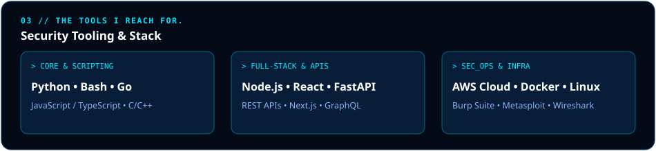

<div align="center">

<!-- 01 // HEADER HERO PANEL -->


<br/><br/>

<!-- ELECTRIC BLUE SOCIAL BADGES -->
<p align="center">
  <a href="https://github.com/sumitkumardev-tech"></a>
  <a href="https://linkedin.com/in/YOUR_LINKEDIN"></a>
  <a href="mailto:your.email@example.com"></a>
</p>

</div>

---

### `01 // RECOGNITION & CREDENTIALS`
> *Proof, on the record.*

<table>
  <tr>
    <td width="50%" bgcolor="#051329">
      <p align="left"><font color="#00e5ff"><b>CTF COMPETITIONS // OFFENSIVE SEC</b></font></p>
      <h2><b>National / Global CTF Solver</b></h2>
      <p>Solved challenges across Web Exploitation, Reverse Engineering, Cryptography, and Privilege Escalation.</p>
      <p><code>Forensics</code> • <code>Network Sec</code> • <code>Pwn</code> • <code>PrivEsc</code></p>
    </td>
    <td width="50%" bgcolor="#051329">
      <p align="left"><font color="#00e5ff"><b>CLOUD ARCHITECTURE // AWS</b></font></p>
      <h2><b>AWS Cloud Computing Badge</b></h2>
      <p>Certified hands-on expertise with AWS IAM, VPC, EC2 isolation, CloudTrail auditing, and multi-tier app security.</p>
      <p><code>AWS Cloud</code> • <code>IAM Hardening</code> • <code>VPC Peering</code> • <code>CloudWatch</code></p>
    </td>
  </tr>
</table>

---

### `02 // PRODUCTS, NOT ASSIGNMENTS.`

<table>
  <tr>
    <td width="50%" bgcolor="#071833">
      <h3 align="left"><font color="#ffffff"><b>01 / Lattix-card</b></font></h3>
      <p>Next-generation dynamic card infrastructure with cryptographic verification layers, tokenized authentication, and high responsiveness.</p>
      <p><font color="#00e5ff"><b>Tech:</b></font> <code>Full-Stack</code> • <code>Cryptography</code> • <code>Security RBAC</code> • <code>Modern UI</code></p>
      <p>
        <a href="https://github.com/sumitkumardev-tech/Lattix-card"><b>[ Inspect Repo ]</b></a> &nbsp;&nbsp;|&nbsp;&nbsp; 
        <a href="#"><b>[ Live Deployment ]</b></a>
      </p>
    </td>
    <td width="50%" bgcolor="#071833">
      <h3 align="left"><font color="#ffffff"><b>02 / Apexflow</b></font></h3>
      <p>High-efficiency automated workflow pipeline engine engineered for zero-trust data throughput, resilient API relays, and real-time state sync.</p>
      <p><font color="#00e5ff"><b>Tech:</b></font> <code>Node.js / Python</code> • <code>Distributed Architecture</code> • <code>Docker</code> • <code>API Gateway</code></p>
      <p>
        <a href="https://github.com/sumitkumardev-tech/Apexflow"><b>[ Inspect Repo ]</b></a> &nbsp;&nbsp;|&nbsp;&nbsp; 
        <a href="#"><b>[ Live Deployment ]</b></a>
      </p>
    </td>
  </tr>
</table>

---

<!-- 03 // TECH ARSENAL SVG PANEL -->
<div align="center">
  
</div>

---

### `04 // COMMIT LOG & RADAR`
> *A year of building, one square at a time.*

<div align="center">
  <!-- Electric Blue GitHub Stats -->
  
  
</div>

<br/>

<div align="center">
  <!-- Electric Cyan / Blue Contribution Heatmap -->
  
</div>

---

### `05 // SYSTEM TERMINAL`
```bash
$ nmap -sV -p 443 portfolio.sumit.dev
PORT    STATE SERVICE  VERSION
443/tcp OPEN  SSL/HTTP Sumit Kumar // Cybersecurity & Full-Stack Engine (Prod: Stable)
$ echo "Let's build something secure and worth explaining."
